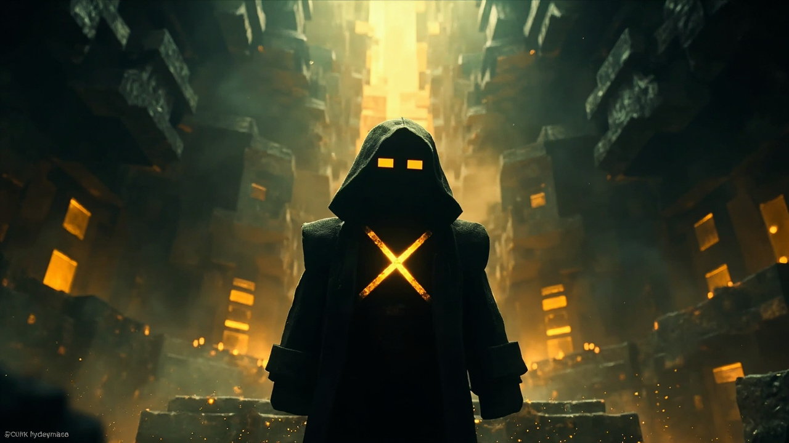
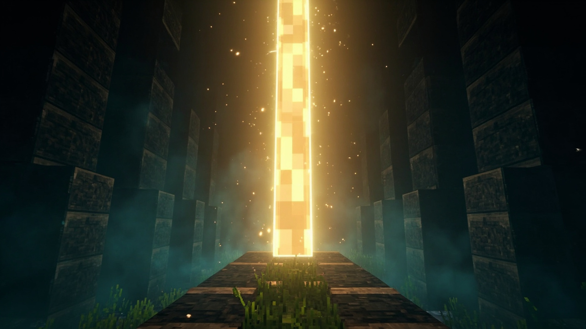

# 《方块之下》/ Awakening: Return of the Builder

> 你不是这个世界的人。但你已经在这片土地上行走了很久。
>
> You are not from this world. But you have walked its roads for a very long time.

一个 Minecraft 剧情冒险 mod —— 玩家扮演沉睡了数千年的远古建造师，**亲手重演 14 段历史**。

A story-driven Minecraft mod: you play an ancient Builder who slept for millennia, **re-enacting fourteen eras of history by hand**.

- **MC 版本**：1.21.4 / Minecraft 1.21.4
- **Mod Loader**：Fabric
- **依赖**：Fabric API 0.110.0+
- **License**：MIT
- **作者**：Jimmy
- **语言**：中文 / English（自动跟随客户端语言，可 `/awakening lang` 手动切换）



---

## 这是什么

不是"看剧情"，是"重演剧情"。每段纪元都是：

1. **剧情文本**（Jimmy 亲手写的 14 段 lore，逐行推进）
2. **一个必须亲手完成的任务** —— 跟村民说话、挖黑曜石、交出灵魂、召唤 Boss、建造信标…
3. 完成后自动推进到下一纪元

两段结构：

- **剧情段**（60~90 分钟）：第一人称扮演远古建造师，从「共生」走到「不归路」
- **自由段**（永久）：终末之诗播放完 → 回到现代 Minecraft 世界，解锁奖励，照常游玩

唯一结局是**终末之诗**。

---

## 安装

1. 安装 [Fabric Loader](https://fabricmc.net/use/installer/) for 1.21.4
2. 下载 [Fabric API](https://modrinth.com/mod/fabric-api) 0.110.0+ for 1.21.4，放进 `mods/`
3. 把 `awakening-rotb-1.1.0.jar` 放进 `mods/`
4. 启动游戏

---

## 怎么开始

进游戏后，你会**先拿到一本书**《前情提要》（Prologue）—— 它讲清楚了你是谁、发生过什么。

**读完那本书，然后输入：**

```
/start
```

剧情从这一刻才开始。在你输入 `/start` 之前，世界不会自动推进，也不会生成任何剧情 NPC —— 你可以先四处走走、看看书。

想再要一本：`/awakening book`

---

## 命令

| 命令 | 作用 |
|---|---|
| **`/start`** | **正式开始剧情（玩家唯一需要记的命令）** |
| `/awakening status` | 查看当前纪元与任务 |
| `/awakening book` | 再要一本《前情提要》 |
| `/awakening lang zh\|en\|auto` | 切换语言（auto = 跟随客户端） |
| `/awakening skip <1-14>` | 跳到指定纪元（调试用） |
| `/awakening freeplay` | 直接进入自由段并领取奖励 |
| `/awakening debug` | 查看剧情 NPC / Boss 状态与背包 |
| `/awakening reset` | 重置剧情进度（需 OP） |

---

## 14 段纪元

| # | 纪元 / Era | 任务 / Objective |
|---|---|---|
| I | 共生 · Symbiosis | 与 3 位村民交谈 |
| II | 下界远征 · The Nether Expedition | 采集 8 个黑曜石 |
| III | 灾厄的善意 · The Scourge's Benevolence | 与灾厄村民交谈（他们不会伤害你） |
| IV | 请求复活 · A Plea for Resurrection | 把 3 个灵魂碎片交给灾厄村民 |
| V | 凋零之罪 · The Sin of the Wither | 在凋零之子的降临中活下来 |
| VI | 凋零病毒 · The Wither Blight | 躲进地下撑过 60 秒 |
| VII | 坚守者 · The Echo Sentinel | 用灵魂与尖啸体召唤坚守者，击败凋零之子 |
| VIII | 信标净化 · The Beacon's Cleansing | 放置共鸣方块，用下界之星净化世界 |
| IX | 灾厄的反噬 · The Scourge's Retaliation | 击败 3 个失控的邪术师 |
| X | 再次躲避 · Hiding Again | 躲进 Y=-40 以下的要塞深处 |
| XI | 末地远征 · The Expedition to the End | 穿过末地传送门 |
| XII | 龙之战 · The War of Dragons | 击败末影龙，留下一条守门龙 |
| XIII | 末地文明 · The Civilization of the End | 收集 16 个末地石与一副鞘翅 |
| XIV | 不归路 · The Road of No Return | 使用末影珍珠碎片 |

**终末之诗 / The Final Poem** —— 唯一结局，播放完毕后进入自由段。

---

## 剧情角色

| 角色 | 实现 | 说明 |
|---|---|---|
| 觉醒者 The Awakener | 村民 | 第一纪的引路人 |
| 邪术师 The Warlocks | 唤魔者 | 第三纪友善 → 第九纪暴走 |
| 末影守护者 The Ender Guardian | 末影人 | 认亲不攻击 |
| 坚守者 The Echo Sentinel | 监守者 | lore：「它看不见，靠震动感知」 |
| 凋零之子 The Wither Son | 凋零 | lore：「三头、六翼、骨骼蓝皮」 |
| 守门龙 The Gate Dragon | 末影龙 | 第十二纪留下的那一条 |

> NPC 与 Boss 全部基于原版实体实现 —— 零客户端崩溃风险，且这些角色本来就长得像村民/末影人/监守者/凋零。



---

## 物品与方块

**物品**：建造师长袍（胸甲）、记录仪、共鸣石、灵魂罗盘、古城通行证、凋零核心、古城钥匙、觉醒者信物、灵魂碎片、末影珍珠碎片、古老唱片 A/B/C

**方块**：古城共鸣方块、觉醒者图腾、建造师石砖、凋零裂隙、强化回响石、灵魂灯、建造师长袍方块

**音乐**：三张原创唱片（纯音乐，D 小调五声 / 全音阶 / A 小调史诗），共 254 秒

**世界生成**：远古古城结构 —— 规则化方形建筑（大厅 + 房间 + 柱子 + 回响石），Y ∈ [-48, -12]。**lore：古城是远古建造师创造的，不是天然洞穴**，所以是规则化建筑而非随机洞穴。

---

## 自由段奖励

剧情结束后获得：建造师长袍、共鸣石、灵魂罗盘、古城通行证、凋零核心、觉醒者信物、古城钥匙、古老唱片 A/B/C。

之后你就是正常 Minecraft 玩家 —— 拆古城、杀村民、退出游戏、玩创造模式，加其他 mod，都行。

---

## 开发

```bash
./gradlew build          # 构建 jar → build/libs/
./gradlew runServer      # 本地测试服务端
node tools/e2e-test.js   # 端到端回归测试（需先启动服务端 + mineflayer）
```

### 项目结构

```
src/main/java/net/awakeningrotb/
├── AwakeningRotb.java          主入口
├── command/AwakeningCommand.java   /start 与 /awakening 命令
├── item/                       物品注册 + 交互行为
├── block/                      方块注册
├── sound/                      音效注册
├── story/                      ★ 剧情核心
│   ├── StoryText.java          自动生成的中文 lore（勿手改）
│   ├── StoryTextEn.java        自动生成的英文 lore（勿手改）
│   ├── L10n.java               自动生成的界面文本中英双份（勿手改）
│   ├── Loc.java                语言运行时（按玩家语言取文本）
│   ├── PrologueBook.java       《前情提要》书（中英双份）
│   ├── Era.java                14 段纪元定义
│   ├── StoryManager.java       调度器（cutscene + 任务轮询）
│   ├── StoryProgress.java      单玩家进度
│   ├── StoryState.java         世界级存档
│   ├── StoryEvents.java        事件 → 任务进度 + 开局发书
│   ├── StoryNpc.java           NPC 生成
│   └── StoryBoss.java          Boss 生成
└── world/
    ├── AncientCityFeature.java 远古古城生成
    └── ModWorldGen.java        注册
```

### lore 文本维护

剧情原文在 `data/awakening/function/eraN.mcfunction`（Jimmy 写的原始版本）+ `STORY.md` 尾声。
英文译文在 `data/awakening/lang/en/*.json`（**行数必须与中文一一对应**）。

三个 Java 文件由脚本生成，**不要手改**：

```bash
python3 tools/gen-i18n.py
```

会重新生成 `StoryText.java`（中文）、`StoryTextEn.java`（英文）、`L10n.java`（界面文本中英双份）。

---

## lore 铁律（不可违背）

1. 坚守者不用 vanilla Warden 的名字 —— 英文 **The Echo Sentinel**，中文 **坚守者**
2. 尖啸体不是 Sculk/Skulk —— 它是建造师主动培育的**菌类共鸣网络**
3. 古城是**远古建造师创造的** —— 不是天然洞穴
4. 灾厄村民不会伤害村民和建造师（初设），后来因为复活术失败才暴怒
5. 灾厄村民的暗黑魔法起源于**修炼**，不是天然存在
6. 凋零病毒和亡灵病毒是**两个独立事件** —— 凋零病毒是辐射伤害，亡灵病毒是死灵操纵
7. 末影龙有"所有"，被打败后**留下一条守门**
8. 末影人是在末地待久了变成的建造师

---

## 致谢

- **Jimmy** —— 全部剧情文本、mod 概念、美术方向
- **Fabric / Yarn / Fabric API** —— mod 生态

MIT License.
